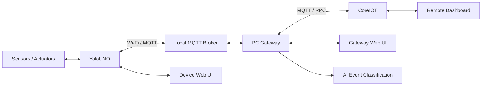

# Smart Classroom IoT

An IoT-based classroom monitoring and automation system developed for the Internet of Things course at HCMUT (Semester 261). The system integrates YoloUNO (ESP32-S3), an AIoT Kit, a PC gateway, and CoreIOT.

**Status:** CoreIOT configuration and local verification completed. Platform deployment, physical integration, and system validation are in progress.

The current hardware configuration focuses on humidity monitoring and board LED control using Yolo UNO. Extended features depend on hardware availability.

Member C's implementation includes dashboard configurations, RuleChain automation, notifications, OTA delivery verification, and a Python integration simulator.

- [CoreIOT Deployment Guide](coreiot/docs/PLATFORM_DEPLOYMENT.md)
- [Demo Guide](coreiot/docs/DEMO.md)
- [Verification Record](coreiot/docs/VERIFICATION.md)

## 1. System Architecture



Telemetry flows from the device to CoreIOT. Control requests flow in the opposite direction, with device acknowledgements and updated actuator states returned to the requesting interface.

## 2. System Features

| ID | Planned feature | Owner |
| --- | --- | --- |
| F01 | Monitor temperature, humidity, light, motion and distance; display readings on LCD and dashboards | A, B, C |
| F02 | Automate lighting based on light and motion; support manual control | A, B, C |
| F03 | Automate fan control based on temperature; report actuator state | A, B, C |
| F04 | Control model door via servo and record proximity events | A, B |
| F05 | Remote monitoring, RPC control, RuleChain automation and threshold notifications | C, B |
| F06 | Gateway AI event classification and local monitoring/control | B |
| F07 | On-device web monitoring and control | A |
| F08 | Remote firmware update through CoreIOT | A, C |

## 3. Technology Targets

| Code | Technology | Owner | Points |
| --- | --- | --- | ---: |
| T07 | On-device web server | A | 1.0 |
| T08 | Bidirectional PC gateway | B | 1.0 |
| T09 | Gateway AI | B | 1.0 |
| T10 | Gateway monitoring and control interface | B | 1.0 |
| T11 | CoreIOT templates, dashboard and remote control | C | 1.0 |
| T12 | RuleChain automation | C | 1.0 |
| T13 | Threshold notifications | C | 0.5 |
| T14 | OTA firmware update | A, C | 2.0 |
| | **Planned technology total** | | **8.5** |
| N06 | Custom event detection and recording dashboard (optional) | B | +1.0 |

Target: 8/8 technology points, 2/2 report points, and up to 1 bonus point, subject to the overall 10-point cap. Points are not claimed until supported by implementation and demo evidence.

## 4. Member Responsibilities

### Member A — Embedded Systems & Firmware (34%)

Branch: `feature/firmware` | Directory: `firmware/` | Targets: T07, T14

- [ ] Confirm hardware inventory, GPIO assignments, power requirements and wiring.
- [ ] Implement DHT20, light, PIR and distance sensor acquisition; handle IR input and LCD output.
- [ ] Implement RGB LED, mini fan and servo drivers, safe startup states and a common command handler.
- [ ] Implement Wi-Fi/MQTT connection, telemetry publishing, command subscription, ACK and reconnect handling.
- [ ] Develop a self-implemented device web server with live readings and actuator controls (T07).
- [ ] Implement OTA client compatible with the CoreIOT update mechanism agreed with C; prepare versioned builds 1.0.0 and 1.1.0 and a recovery build (T14).
- [ ] Document build, flash, configuration and hardware test procedures.

**Deliverables:** Firmware source, sample configuration, pin mapping, wiring diagram, firmware flowchart, hardware photos, serial logs, device web screenshots and OTA builds.

**Acceptance:** Sensors produce valid readings; local and MQTT commands control the intended actuator and return reported state; reconnect works; firmware builds successfully. OTA remains pending until a real update is verified.

### Member B — IoT Gateway & AI (33%)

Branch: `feature/gateway` | Directories: `gateway/`, `ai/` | Targets: T08, T09, T10; optional N06

- [ ] Set up a local MQTT broker and Python gateway with configurable connections.
- [ ] Implement telemetry validation, forwarding to CoreIOT and per-device state tracking.
- [ ] Receive CoreIOT RPC requests, route commands to the correct device and correlate ACKs; handle timeouts, duplicates and reconnects (T08).
- [ ] Develop local monitoring and actuator control UI using the same command path (T10).
- [ ] Create a simulated device that publishes telemetry and responds to commands without hardware.
- [ ] Define event classes and input features; collect and label data, train a model, evaluate on held-out data and export the model.
- [ ] Run AI inference on the gateway and publish event results to CoreIOT (T09).
- [ ] Optionally extend the local UI to detect, display and persist events (N06).
- [ ] Maintain integration test records and measurement scripts.

**Deliverables:** Gateway source, dependency list, sample configuration, simulator, local UI, AI training/inference code, dataset provenance, trained model, evaluation metrics and logs.

**Acceptance:** Simulator-to-gateway-to-CoreIOT telemetry works; RPC round trips return correlated ACKs; local controls work; trained AI produces event results and evaluation evidence. Simulated results must be identified as such.

### Member C — CoreIOT & System Integration (33%)

Branch: `feature/coreiot` | Directory: `coreiot/` | Targets: T11, T12, T13, T14

- [ ] Configure CoreIOT devices, device profiles, templates and dashboard.
- [ ] Display environmental readings, actuator states, firmware version and AI events.
- [ ] Implement remote lamp, fan and door controls using RPC; distinguish pending, confirmed and failed commands (T11).
- [ ] Configure RuleChain lighting and fan automation with agreed thresholds and manual override policy (T12).
- [ ] Configure threshold notifications and verify actual receipt (T13).
- [ ] Verify OTA permissions and supported update mechanism with A; upload firmware packages, assign versions and monitor update status (T14).
- [ ] Test cloud functionality with synthetic telemetry and simulated command responses before hardware integration.
- [ ] Export supported dashboard/RuleChain configurations and document import/setup steps.
- [ ] Coordinate pull requests, integration, report consolidation and final demo.

**Deliverables:** CoreIOT configuration exports, dashboard screenshots, RPC documentation, RuleChain diagram, notification evidence and OTA configuration/logs.

**Acceptance:** Dashboard displays synthetic telemetry; RPC is tested with a simulator; automation and notification rules are verified. Real device control and OTA require integrated validation.

## 5. Shared Interface

All members must follow [shared/PROTOCOL.md](shared/PROTOCOL.md).

| MQTT topic | Direction |
| --- | --- |
| `classroom/{deviceId}/telemetry` | Device → Gateway |
| `classroom/{deviceId}/cmd` | Gateway → Device |
| `classroom/{deviceId}/ack` | Device → Gateway |

Telemetry fields: `deviceId`, `ts`, `temperature`, `humidity`, `light`, `motion`, `distance`, `lamp`, `fan`, `door`, `fwVersion`.

Commands: `setLamp`, `setFan`, `setDoor` with a unique command ID and boolean value. ACKs must include the matching ID, execution result and reported state.

CoreIOT RuleChain owns automatic lighting and fan decisions. Manual override suppresses automation until released. Agree on override fields, thresholds, sampling interval, event classes and CoreIOT RPC/OTA interfaces before implementation. Do not introduce competing automation rules.

## 6. Repository Structure

```text
smart-classroom-iot/
├── firmware/             # A
├── gateway/              # B
├── ai/                   # B
├── coreiot/              # C
├── shared/PROTOCOL.md    # Shared interface
├── tests/                # Test cases and measurement records
├── docs/DEVELOPMENT.md   # Development plan
├── .gitignore
└── README.md
```

## 7. Development Workflow

Clone the repository and switch to the assigned branch:

```bash
git clone https://github.com/VinhTechiee/smart-classroom-iot.git
cd smart-classroom-iot
git switch feature/firmware
```

Members B and C use `feature/gateway` and `feature/coreiot` respectively. After accepting the repository invitation, commit changes under your own account.

```bash
git pull
git add <changed-files>
git commit -m "feat(firmware): implement sensor acquisition"
git push
```

Use pull requests into `main` for reviewed changes. Do not commit directly to `main`, change the shared protocol without team approval, or commit Wi-Fi passwords, tokens or credentials. Provide sample configuration files instead.

## 8. Pre-integration and Validation

| Gate | Acceptance criteria |
| --- | --- |
| 1. Interface freeze | Confirm device count requirement, OTA support, hardware pinout, message schema and control policy |
| 2. Independent development | A validates firmware on kit or available hardware; B tests with simulated device; C tests with simulated gateway |
| 3. Core integration | Real telemetry reaches CoreIOT; device web, gateway UI and remote RPC control work with ACKs |
| 4. Intelligent features | RuleChain, alerts and gateway AI operate on integrated data |
| 5. OTA and regression | Real firmware version changes; core functions still work; recovery build available |
| 6. Evidence and submission | Collect measurements, screenshots, logs, report and demo video |

Physical integration should begin only after individual module checks pass. Verify the lecturer's multiple-device requirement and CoreIOT OTA support before committing to the final hardware scope.

## 9. Testing and Evidence

| Test | Evidence | Owner |
| --- | --- | --- |
| Sensor acquisition and device web control | Serial logs, photos, screenshots | A |
| Telemetry and remote control latency | At least 10 trials per metric; min, mean, max; correlated ACKs | A, B, C |
| Gateway reconnect and RPC timeout | Disconnect/reconnect and failure logs | B |
| AI classification | Held-out test results, confusion matrix, precision, recall, macro-F1 and inference time | B |
| Dashboard, RuleChain and alerts | Configuration screenshots and received notifications | C |
| OTA | Before/after firmware versions, update logs and regression results | A, C |

Store raw measurement records in `tests/`. Distinguish synthetic data from real measurements and firmware-reported states from independently measured physical states.

## 10. Report and Submission

Follow the official IoT report template. See [docs/DEVELOPMENT.md](docs/DEVELOPMENT.md) for detailed report ownership.

| Member | Report responsibility |
| --- | --- |
| A | Sensor layer, hardware list, wiring, firmware and device communication; build/flash guide |
| B | Architecture, functional decomposition, communication/gateway/AI layers, gateway and AI implementation; test results consolidation |
| C | Introduction, application layer, technology mapping, CoreIOT implementation, conclusion and front matter; final report consolidation |

All members contribute their own testing evidence and installation instructions.

Required submission: report PDF (`[ClassCode]_[GroupCode]_IoTReport.pdf`), GitHub repository with individual commit history, and a 5–10 minute recommended demo video. Include at least five quality IEEE-style references, technology self-assessment with evidence, contribution table totaling 100%, and disclosure of AI assistance.

## References

- Course Project Announcement — Internet of Things, Semester 261.
- Official IoT Course Project Report Template.
- [OhStem AIoT Kit](https://ohstem.vn/san-pham/aiot-kit-hoc-lap-trinh-iot-va-ai/).
