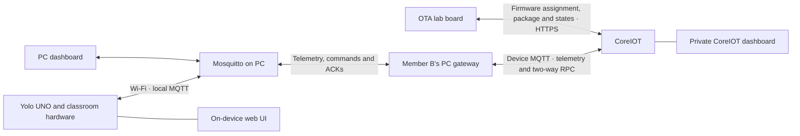

# Smart Classroom system demonstration



## Prepare the physical classroom

- Use a Yolo UNO ESP32-S3, the modules below, a USB data cable, and a PC with Python 3.10+, PlatformIO, and Mosquitto. Confirm the board revision and trace each connector to the configured GPIO before powering the wiring. The build uses an 8 MB layout with two OTA app slots. [OhStem Yolo UNO documentation](https://wiki.ohstem.vn/yolo_uno)
- Put the PC and board on the same isolated 2.4 GHz network with client isolation disabled. Allow TCP 1883 to the PC from that network only. The board needs DNS and NTP for command deadlines, and the OTA lab also needs HTTPS to `app.coreiot.io`. The PC dashboard binds to loopback.
- Use distinct CoreIOT entities and credentials for `classroom-01` (physical), `classroom-01-sim` (synthetic), `classroom-ota-virtual` (HTTPS package verification), and `classroom-ota-board` (native OTA). The OTA board's own HTTPS client and its PC gateway use the token for that same lab entity. Keep the direct simulator on the synthetic entity.

| Hardware | Firmware wiring defaults | Confirm on the bench |
| --- | --- | --- |
| DHT20 and 16×2 LCD backpack | SDA GPIO 11, SCL GPIO 12, 100 kHz. DHT20 address `0x38`, LCD default `0x21` | Scan the actual addresses. Keep ESP32-side pull-ups at 3.3 V. Use a bidirectional I²C level shifter if the LCD pulls its bus to 5 V. |
| Ultrasonic | TRIG GPIO 6, ECHO GPIO 7 | Confirm the module supply and signal levels. Level-shift any 5 V ECHO to 3.3 V. Confirm that the module accepts the 3.3 V trigger. |
| Servo | PWM GPIO 5, 50 Hz, 0° closed and 90° open | Use a supply sized for the servo's stall current, with common ground. Test both angles with the linkage unloaded before connecting the door. |
| Analog light | GPIO 1, ADC1, 12-bit raw | Confirm safe input voltage and whether raw readings rise or fall in darkness. |
| PIR | GPIO 10, active high, 30-second warm-up | Confirm module supply, output voltage, polarity and warm-up. Motion is unavailable during firmware warm-up. |
| Controllable LED and warning RGB | Lamp GPIO 48, active high. Independent one-pixel RGB GPIO 45 | These are inherited defaults. An OhStem-compatible variant maps a NeoPixel to GPIO 48. Confirm two independent outputs and their types on the actual revision before commissioning. |

Override only verified wiring in ignored `firmware/include/config.local.h`, using [the hardware example](../firmware/include/hardware.example.h). The Yolo UNO build checks GPIO collisions, ADC1 and the LCD address at compile time. `yolo_bit` and `yolo_bit_ota` remain separate. For isolated development, `yolo_uno_mock` uses synthetic readings and the `classroom-01-sim` identity.

[Yolo UNO Arduino variant](https://github.com/AITT-VN/orc_hub_arduino_examples/blob/main/variants/yolo_uno/pins_arduino.h) · [ESP32-S3 ADC pins](https://docs.espressif.com/projects/esp-idf/en/v4.4/esp32s3/api-reference/peripherals/adc.html)

From the repository root, prepare Python, firmware secrets, and the gateway environment. Preserve existing local files.

```powershell
python -m venv .venv/coreiot
& .venv/coreiot/Scripts/python.exe -m pip install -r gateway/requirements.txt
if (-not (Test-Path firmware/include/secrets.h)) { Copy-Item firmware/include/secrets.example.h firmware/include/secrets.h }
if (-not (Test-Path gateway/.env)) { Copy-Item gateway/.env.example gateway/.env }
```

Set Wi-Fi credentials, the PC LAN address as `MQTT_HOST`, and the `classroom-board` broker credentials in `firmware/include/secrets.h`. Leave mock mode off. In `gateway/.env`, use `127.0.0.1:1883` via the local host and port fields, the `classroom-gateway` broker credentials, `GATEWAY_COREIOT_DEVICE_ID=classroom-01`, and the physical CoreIOT token in `GATEWAY_COREIOT_DEVICE_TOKEN`. Use the tenant's verified certificate-validated MQTT TLS endpoint when available. The existing `mqtt://app.coreiot.io:1883` endpoint is the course sandbox endpoint and carries credentials in plaintext.

On a fresh broker, create the password file once. Set a different password for each user.

```powershell
if (-not (Test-Path gateway/config.local.passwords)) {
    mosquitto_passwd -c gateway/config.local.passwords classroom-board
    mosquitto_passwd gateway/config.local.passwords classroom-gateway
    mosquitto_passwd gateway/config.local.passwords classroom-ota-board
}
mosquitto -c gateway/mosquitto.demo.conf -v
```

Run one bridge per CoreIOT entity. Start these commands in separate PowerShell terminals.

```powershell
& .venv/coreiot/Scripts/python.exe -m gateway.bridge --env-file gateway/.env
& .venv/coreiot/Scripts/python.exe -m gateway.web --env-file gateway/.env
```

Build the board firmware. After Member A confirms the pinout and you have approval to flash, identify the USB port and upload.

```powershell
pio run -d firmware -e yolo_uno
pio device list
$boardPort = Read-Host 'Yolo UNO COM port'
pio run -d firmware -e yolo_uno -t upload --upload-port $boardPort
pio device monitor -d firmware -e yolo_uno -p $boardPort
```

## Commission and demonstrate

1. Open the board IP from serial and the gateway UI at `http://127.0.0.1:8080`. Check genuine RH and temperature, vary light, wait for PIR warm-up and move in front of it, then move an object through the ultrasonic range. Observe the three LCD pages and the independent RGB warning. A missing DHT20 reading or echo should appear unavailable in the next local report.
2. Exercise the door on the bench. It opens at ≤15 cm, holds in the deadband, and closes after consecutive readings ≥25 cm spanning at least five seconds. An invalid reading resets the close hold. From the PC or board UI, command CLOSE with an object nearby and verify it stays closed. Select automatic mode explicitly and verify it opens again. Door mode starts automatic after reboot.
3. In CoreIOT **Dashboards → Import**, load [Smart Classroom - Physical](../coreiot/platform/smart-classroom-expanded.dashboard.json) as a new private dashboard under the existing tenant. Confirm the entity alias resolves only to `classroom-01` on the **Smart Classroom** profile. Test Boolean two-way `setLamp` and `setDoor` against the physical output. Record the ACK and a separate fresh `lamp` or `door` report. Check reconnect by interrupting the board and PC gateway separately.
4. Inspect **Root RuleChain → Save Timeseries → Success → Smart Classroom - Humidity** without replacing the chain. Check sample times and typed attributes. Commission with Boolean `classroomAutomationEnabled=false` and `classroomManualOverride=true`, and use String `classroomHumidityMeasurement=relative_air_humidity` after confirming the sensor. Verify 65%, 85%, 77% and 70% in the synthetic sandbox, including threshold notification and recovery. Release physical automation only after the sandbox acceptance and operator approval. Set override before manual LED trials and let any in-flight RPC resolve. [RuleChain setup](../coreiot/minimal/AUTOMATION.md) · [Sandbox scenarios](../coreiot/docs/PLATFORM_DEPLOYMENT.md#9-enable-automation-in-stages-on-the-simulator)
5. Use light/PIR control only on a separately calibrated bench build. Set `SMART_CLASSROOM_LIGHT_POLARITY` to `+1` for low-is-dark or `-1` for high-is-dark, with thresholds measured on the normalized scale. The 30-second occupancy timeout remains in effect. This build rejects CoreIOT LED commands. Keep `0` for the default humidity-based demonstration.
6. For an audience link, import the [public monitoring dashboard](../coreiot/platform/smart-classroom-public.dashboard.json) separately. Bind it to an approved `classroom-public` telemetry-only entity with temperature and humidity. Keep both physical devices and the control dashboard private. Verify the public link in a signed-out window. [Dashboard sharing](https://thingsboard.io/docs/pe/user-guide/dashboards/)

## Native OTA demonstration and recovery

Run both application builds and record each file's byte count and SHA-256. Use `firmware/.pio/build/yolo_uno_coreiot_100/firmware.bin` for 1.0.0 and `firmware/.pio/build/yolo_uno_coreiot_110/firmware.bin` for 1.1.0. Both OTA slots hold 3,342,336 bytes each. Upload the application images to the separate OTA lab profile with title `smart-classroom-yolouno` and per-device assignment. Verify both downloads with `classroom-ota-virtual` and its own token first. [Package delivery and acceptance](../coreiot/platform/OTA.md)

```powershell
pio run -d firmware -e yolo_uno_coreiot_100 -e yolo_uno_coreiot_110
& .venv/coreiot/Scripts/python.exe -c "import hashlib,pathlib; [print(p.parent.name,p.stat().st_size,hashlib.sha256(p.read_bytes()).hexdigest()) for p in sorted(pathlib.Path('firmware/.pio/build').glob('yolo_uno_coreiot_*/firmware.bin'))]"
```

Use [the NVS sample](../firmware/nvs.ota.example.csv) as `build/ota/lab.csv`. Fill in the lab board's private network and CoreIOT settings, reviewed `1.1.0` size and digest, and the absolute path to the PEM trust anchor for the tenant. Keep the CSV and generated NVS image local. The board uses the provisioned digest to approve the exact release. Obtain Espressif's NVS partition generator, set `$nvsGen` to its script path, and run from the repository root. [NVS partition generator](https://docs.espressif.com/projects/esp-idf/en/v5.1/esp32/api-reference/storage/nvs_partition_gen.html)

```powershell
python $nvsGen generate build/ota/lab.csv build/ota/lab-nvs.bin 0x5000
```

After flash approval and with the lab assignment clear, program the baseline and seed the NVS partition. Verify the active PlatformIO default 8 MB layout before writing the NVS offset. Set `gateway/.env.ota` separately for `classroom-ota-board` and start the bridge and dashboard using that file.

```powershell
pio run -d firmware -e yolo_uno_coreiot_100 -t upload --upload-port $boardPort
$pioPython = Join-Path $env:USERPROFILE '.platformio/penv/Scripts/python.exe'
$espTool = Join-Path $env:USERPROFILE '.platformio/packages/tool-esptoolpy/esptool.py'
& $pioPython $espTool --chip esp32s3 --port $boardPort write_flash 0x9000 build/ota/lab-nvs.bin
```

Verify running `1.0.0` and manual LED control. Assign `1.1.0` to the lab board only. Capture actual download, verification, installation and post-reboot status in CoreIOT and serial. Check `current_fw_version` and fresh `fwVersion`, then repeat sensor, LCD, LED, door and reconnect checks. The lab client turns off the lamp, pauses automatic door movement during install, and gates `UPDATED` on a fresh DHT20 reading, known lamp state, and the local MQTT connection.

For recovery, clear the assignment first, then load the known-good `yolo_uno_coreiot_100` USB build with Member A. Verify the booted version and reset the lab NVS record using the reviewed NVS image if a failed attempt remains recorded. Repeat the baseline tests. The USB recovery path still requires a board rehearsal. For LAN maintenance on the ordinary build, Member A's optional ArduinoOTA environment is `yolo_uno_ota`.

## Troubleshooting

| Symptom | Check |
| --- | --- |
| No board telemetry | PC LAN IP, firewall and broker ACL, exact device ID, genuine DHT20 acquisition and recent timestamp. Unsupported fields arrive as null locally and are omitted in cloud values. |
| RPC timeout or `clock_unsynchronized` | Confirm both clocks, NTP reachability, subscription to the per-device command topic and the matching ACK. A timeout leaves the outcome unknown until a fresh report arrives. |
| No rule or notification | Check the reason on the signed-in RuleChain path, stored sample timestamp, numeric thresholds and Boolean flags, and notification routing on the alarm creation event. |
| OTA fails | Confirm the lab token, CA and time, assigned package title/version, exact Content-Length and reviewed SHA-256. Use serial and `fw_error` to locate the failed stage. |
